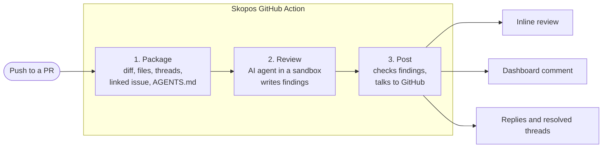
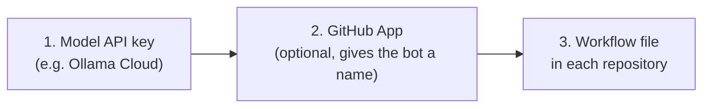
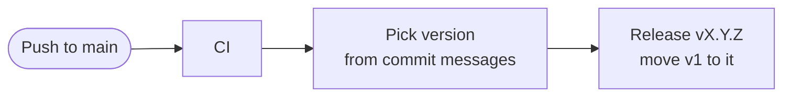

# Skopos

*σκοπός: "watcher, lookout"*

Skopos is an AI reviewer for GitHub pull requests. On every push it reads the
change and posts:

- **a few inline findings**, each with a ready-to-commit fix where possible
- **one dashboard comment** that lists every finding and its status
- **replies** in its own threads, which it **resolves** once you fix the code

It works with any language and any OpenAI-compatible model.

## How it works



The AI never gets a GitHub token. It can only read the packaged pull request and
write findings to a folder. A plain Python script then checks every finding and
posts it.

## Setup

Steps 1 and 3 are required and take about a minute each. Step 2 is optional.



### 1. Store the model API key

```bash
gh secret set SKOPOS_LLM_API_KEY --repo <owner>/<repo>
```

For an organization, use `--org <org> --visibility all` instead of `--repo`.
The default model is `glm-5.3` on [Ollama Cloud](https://ollama.com). Any
OpenAI-compatible provider works ([how](docs/usage.md#use-a-different-model)).

### 2. Optional: give the bot its own name

Without this step Skopos posts as `github-actions[bot]`. With a GitHub App it
posts as `<your-app>[bot]`. See [Create the GitHub App](docs/usage.md#create-the-github-app).

### 3. Add the workflow

Save this as `.github/workflows/skopos.yml`:

```yaml
name: Skopos review
on:
  pull_request:
    types: [opened, synchronize, reopened, ready_for_review]
concurrency:
  group: skopos-${{ github.event.pull_request.number }}
  cancel-in-progress: true
permissions:
  contents: write # lets Skopos resolve its own threads
  pull-requests: write
jobs:
  review:
    if: >-
      !github.event.pull_request.draft &&
      !contains(github.event.pull_request.labels.*.name, 'skip-skopos') &&
      github.event.pull_request.user.type != 'Bot'
    runs-on: ubuntu-latest
    timeout-minutes: 30
    continue-on-error: true
    steps:
      - uses: johannesE/skopos@v1
        with:
          llm_api_key: ${{ secrets.SKOPOS_LLM_API_KEY }}
          app_client_id: ${{ vars.SKOPOS_APP_CLIENT_ID }}
          app_private_key: ${{ secrets.SKOPOS_APP_PRIVATE_KEY }}
```

Open a pull request. The review appears a few minutes later.

### Or let your coding agent do it

Paste this into Claude Code, Codex, Cursor or a similar agent, inside the
repository you want reviewed:

```text
Add the Skopos AI pull request reviewer to this repository.

1. Create .github/workflows/skopos.yml with exactly the content of
   https://raw.githubusercontent.com/johannesE/skopos/v1/examples/workflows/skopos.yml
2. Run `gh secret list` and `gh variable list`. If SKOPOS_LLM_API_KEY is
   missing, stop and tell me to run:
   gh secret set SKOPOS_LLM_API_KEY --repo <this repo>
   Never ask me to paste a secret into the chat.
3. Add .skopos/ to .gitignore.
4. Create a branch, commit, push and open a pull request. Skopos reviews that
   pull request itself, so tell me its URL.
```

More prompts (project checklists, rolling out to many repositories) are in
[docs/usage.md](docs/usage.md#prompts-for-your-coding-agent).

## Working with the reviewer

| You want to | Do this |
|---|---|
| Get a new review | Push to the pull request |
| Accept a finding | Commit the suggestion or fix the code; Skopos resolves the thread |
| Reject a finding | Reply `by design`, `intentional` or `false positive`; it is not raised again |
| Skip one pull request | Add the `skip-skopos` label |
| Skip draft PRs | Nothing; drafts are skipped automatically |
| Teach it your rules | Add checklists to `.github/skopos/checklists/` ([how](docs/usage.md#project-checklists)) |

## Documentation

- [docs/usage.md](docs/usage.md): GitHub App, secrets, prompts, checklists,
  options, security, troubleshooting
- [Releases](https://github.com/johannesE/skopos/releases): what changed in each version

## Development

```bash
uv run --no-project --with pytest --with pyyaml python -m pytest -q tests
uvx ruff check .
uvx --from actionlint-py actionlint
shellcheck scripts/*.sh bin/skopos-post
```

### Releases

Every push to `main` is released automatically, after CI passes:



The version comes from the commit messages since the last release
([Conventional Commits](https://www.conventionalcommits.org)):

| Commit message | Example | Release |
|---|---|---|
| `type!:` or a `BREAKING CHANGE:` footer | `feat!: rename the model input` | major: `v2.0.0` |
| `feat:` | `feat: add a max_files input` | minor: `v1.1.0` |
| anything else | `fix: …`, `docs: …`, `chore: …` | patch: `v1.0.1` |

With squash merges, the pull request title becomes the commit message, so give
pull requests a Conventional Commit title. A major release creates a new major
tag (`v2`); `v1` users stay on `v1`.
