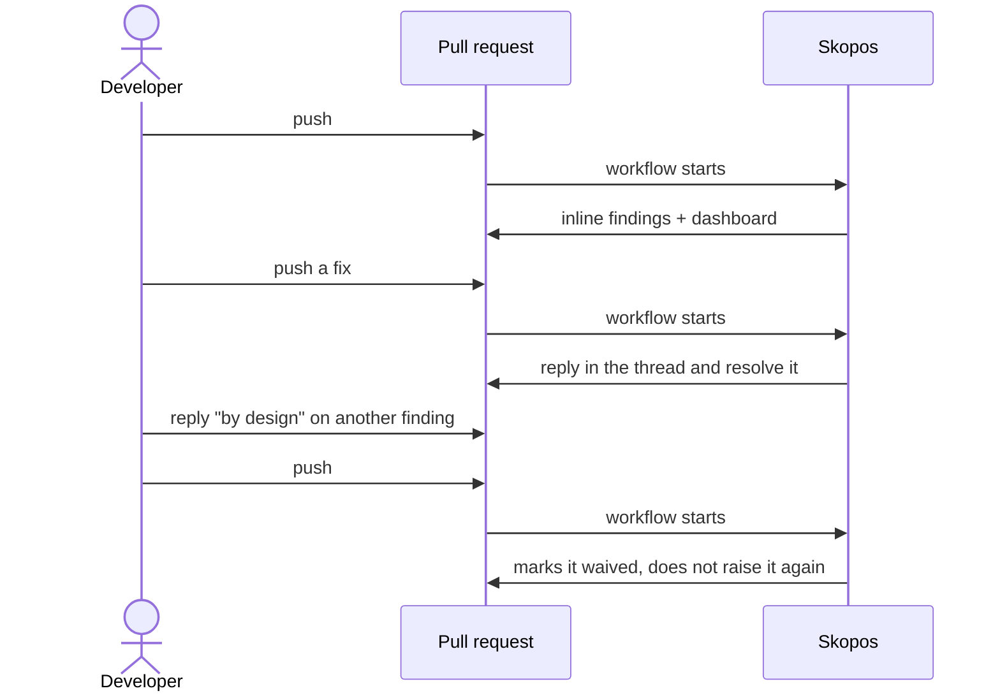
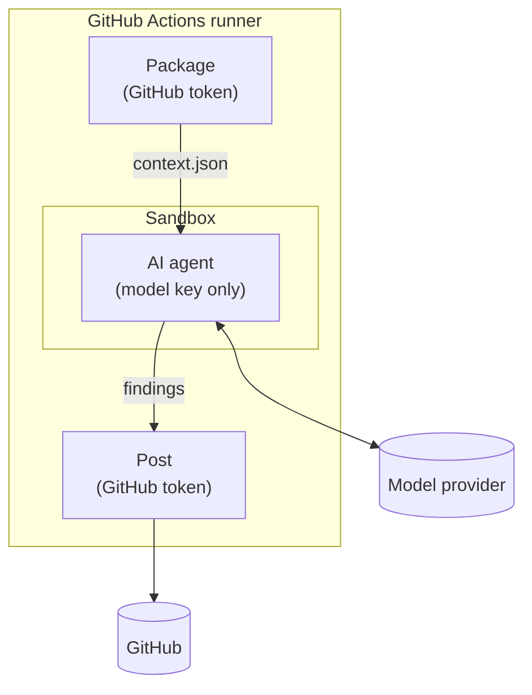

# Skopos usage guide

Everything beyond the quick start in the [README](../README.md).

- [Secrets and variables](#secrets-and-variables)
- [Create the GitHub App](#create-the-github-app)
- [Prompts for your coding agent](#prompts-for-your-coding-agent)
- [Project checklists](#project-checklists)
- [Use a different model](#use-a-different-model)
- [Options](#options)
- [What happens on each push](#what-happens-on-each-push)
- [Security](#security)
- [Troubleshooting](#troubleshooting)

## Secrets and variables

| Name | Type | Needed | Value |
|---|---|---|---|
| `SKOPOS_LLM_API_KEY` | secret | yes | API key of your model provider |
| `SKOPOS_APP_CLIENT_ID` | variable | optional | Client ID of your GitHub App |
| `SKOPOS_APP_PRIVATE_KEY` | secret | optional | Private key (`.pem` file) of that App |

Set them for one repository:

```bash
gh secret set SKOPOS_LLM_API_KEY --repo <owner>/<repo>
gh variable set SKOPOS_APP_CLIENT_ID --repo <owner>/<repo> --body "<client id>"
gh secret set SKOPOS_APP_PRIVATE_KEY --repo <owner>/<repo> < <app>.private-key.pem
```

Or once for a whole organization: replace `--repo <owner>/<repo>` with
`--org <org> --visibility all`. Personal accounts have no account-wide secrets,
so set them on each repository.

`gh secret set` without `--body` asks for the value, so the key stays out of your
shell history. Delete the `.pem` file once it is stored.

If you skip the App, Skopos posts with the workflow's own token as
`github-actions[bot]`. If only one of the two App values is set, it does the same
and shows a warning.

## Create the GitHub App

The App gives Skopos its own name (`<app>[bot]`) and a short-lived token for
each run. It never receives webhooks, so there is no server to run.

1. Go to **Settings → Developer settings → GitHub Apps → New GitHub App**. For an
   organization, use the organization's settings.
2. **Name:** anything, e.g. `skopos-<org>`. **Homepage URL:** any URL, e.g.
   `https://github.com/johannesE/skopos`.
3. **Webhook:** uncheck *Active*.
4. **Repository permissions:**
   - Contents: Read and write (GitHub requires it to resolve review threads)
   - Issues: Read-only
   - Pull requests: Read and write
5. **Where can this App be installed:** Only on this account.
6. Click **Create GitHub App**, copy the **Client ID**, and click **Generate a
   private key**. A `.pem` file downloads.
7. Click **Install App** and choose the repositories to review.
8. Store the Client ID and the `.pem` as shown [above](#secrets-and-variables).

## Prompts for your coding agent

Paste these into Claude Code, Codex, Cursor or a similar agent. Each one ends
with a pull request, and Skopos reviews that pull request.

### Add Skopos to this repository

```text
Add the Skopos AI pull request reviewer to this repository.

1. Create .github/workflows/skopos.yml with exactly the content of
   https://raw.githubusercontent.com/johannesE/skopos/v1/examples/workflows/skopos.yml
2. Run `gh secret list` and `gh variable list`. If SKOPOS_LLM_API_KEY is
   missing, stop and tell me to run:
   gh secret set SKOPOS_LLM_API_KEY --repo <this repo>
   Never ask me to paste a secret into the chat.
3. Add .skopos/ to .gitignore.
4. Create a branch, commit, push and open a pull request. Skopos reviews that
   pull request itself, so tell me its URL.
```

### Write project checklists

```text
Write review checklists for Skopos, the AI pull request reviewer used in this
repository.

1. Read AGENTS.md, CLAUDE.md, README.md and the code to learn the stack,
   conventions and the mistakes that matter here. Ask me what to focus on
   before writing anything.
2. Create 2-4 files under .github/skopos/checklists/, named check-<topic>.md.
   Use the format of
   https://raw.githubusercontent.com/johannesE/skopos/main/docs/checklist-template.md
   Keep each one to 8-12 items. Point each item to the place where the rule is
   written down (an AGENTS.md section, a doc) instead of restating it.
3. Create a branch, commit, push and open a pull request.
```

### Roll out to many repositories

```text
Add the Skopos AI pull request reviewer to these repositories: <repo-a>, <repo-b>, ...

For each repository:
1. Clone it into a temporary folder.
2. Skip it if .github/workflows/skopos.yml already exists.
3. Add .github/workflows/skopos.yml with exactly the content of
   https://raw.githubusercontent.com/johannesE/skopos/v1/examples/workflows/skopos.yml
   and add .skopos/ to .gitignore.
4. Create a branch, commit, push and open a pull request titled
   "Add Skopos pull request review".

Do not set or read any secrets. At the end, list the pull request URLs and the
repositories that are missing SKOPOS_LLM_API_KEY (check with `gh secret list`).
```

For an organization you can also offer Skopos as a workflow template. In the
organization's `.github` repository, add two files:

- `workflow-templates/skopos.yml`: a copy of `examples/workflows/skopos.yml`
- `workflow-templates/skopos.properties.json`:

  ```json
  { "name": "Skopos review", "description": "AI pull request review", "iconName": "octicon eye" }
  ```

Every repository can then add it from **Actions → New workflow**.

## Project checklists

Skopos always runs its built-in checks: standards, code quality, edge cases,
security, performance, tests, logging, architecture and documentation.

You can add your own. Every markdown file in `.github/skopos/checklists/` runs on
top of the built-in checks. Each file says when it applies.

A checklist looks like [checklist-template.md](checklist-template.md):

```markdown
---
name: code-review.check.api-regressions
description: Catch breaking changes to the public REST API.
---

# API regressions

## When to run

When the PR changes files under `src/api/` or `openapi.yaml`.

## Checklist

- [ ] No endpoint is removed or renamed without a deprecation period (`AGENTS.md` API)
- [ ] No optional parameter becomes required
- [ ] No response field is removed or renamed

## Severity guidance

| Finding | Severity |
|---|---|
| Breaking change without deprecation | Critical |
| Missing changelog entry | Minor |

## Do not flag when

- the change only adds a new endpoint, field or optional parameter
```

Tips:

- **Point to your docs.** Skopos reads `AGENTS.md` and `CLAUDE.md`, so a rule that
  cites them is checked against the real text.
- **Say what not to flag.** That cuts false findings more than anything else.
- **Keep it short.** A focused list of 8-12 items beats a long one.

## Use a different model

Any OpenAI-compatible endpoint works:

```yaml
- uses: johannesE/skopos@v1
  with:
    llm_api_key: ${{ secrets.SKOPOS_LLM_API_KEY }}
    model: <model-id>
    provider_base_url: https://api.openai.com/v1
    provider_name: OpenAI
```

A self-hosted server works too if the runner can reach it, e.g.
`provider_base_url: http://llm.internal:11434/v1`.

## Options

| Input | Default | What it does |
|---|---|---|
| `llm_api_key` | — | Model API key. Empty: the review is skipped |
| `app_client_id` | `""` | GitHub App client ID |
| `app_private_key` | `""` | GitHub App private key |
| `github_token` | workflow token | Used unless both App values are set |
| `model` | `glm-5.3` | Model ID at the provider |
| `provider_base_url` | `https://ollama.com/v1` | OpenAI-compatible endpoint |
| `provider_name` | `Ollama Cloud` | Name shown in logs |
| `project_checklists_dir` | `.github/skopos/checklists` | Where your checklists live; `""` turns them off |
| `max_changed_lines` | `0` | Skip PRs larger than this; `0` means no limit |
| `engine_version` | pinned | Version of the review engine |
| `upload_artifacts` | `true` | Upload the review files and logs |
| `artifacts_retention_days` | `7` | How long to keep them |

## What happens on each push



- Each finding is matched to the thread it already has, so new pushes never
  create duplicates.
- Skopos only resolves threads it opened. Threads that people open stay theirs.
- Critical, major and minor findings go inline. Nitpicks stay on the dashboard.
- `thanks`, `ok` or an emoji is not a rejection.
- A newer push cancels a running review.

## Security



- The AI agent runs with an empty environment. It gets the model key and nothing
  else: no GitHub token, no runner variables.
- It cannot use the web, plugins or MCP servers, can only run a short
  allowlist of commands, and can only write to its output folder. The repository
  under review cannot loosen these rules.
- Before anything is posted, Skopos refuses any finding that contains the model
  key or the GitHub token.
- The App token is valid for one hour, for the current repository only, with
  just the permissions listed above.
- Skopos needs *Contents: write* only because GitHub requires it to resolve
  review threads. Only the posting script holds the token, and it only
  creates comments, replies and resolves its own threads. The AI agent never
  sees it.
- Skopos runs `uv` with `--no-config`, so the repository under review cannot
  change where its Python dependencies come from.
- Pull requests from forks get no secrets from GitHub, so they are skipped.
  Skopos never uses `pull_request_target`.

## Troubleshooting

| You see | Why |
|---|---|
| "No LLM API key available" | Fork PR, or the secret is not set for this repository |
| "Only one of app_client_id / app_private_key is set" | Set both App values, or neither |
| `Resource not accessible by integration` | The App is not installed on this repository or lacks *Pull requests: write*; without an App, the workflow lacks `pull-requests: write` |
| "Could not resolve fixed threads" | The token lacks *contents: write*; Skopos still replies, but cannot resolve |
| App token step fails after upgrading | The App still has *Contents: Read-only*; change it to *Read and write* and accept the new permissions on the installation |
| "Review engine exited with an error" | Wrong model ID or base URL; see `agent.log` in the run's artifact |
| Findings missing from the PR | The finding pointed outside the diff; see `posting-skipped.jsonl` in the artifact |
| Two dashboards | Two runs posted at once; keep the `concurrency` block from the example |

Each run uploads its review files and logs as an artifact named `skopos-review-pr<number>-…`.
